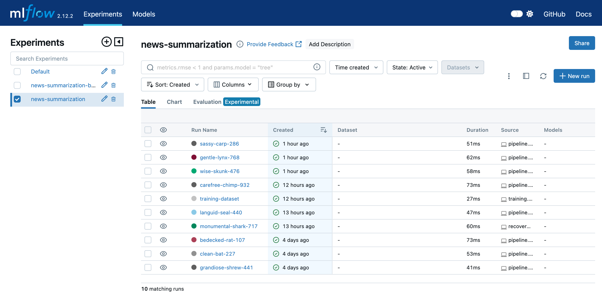
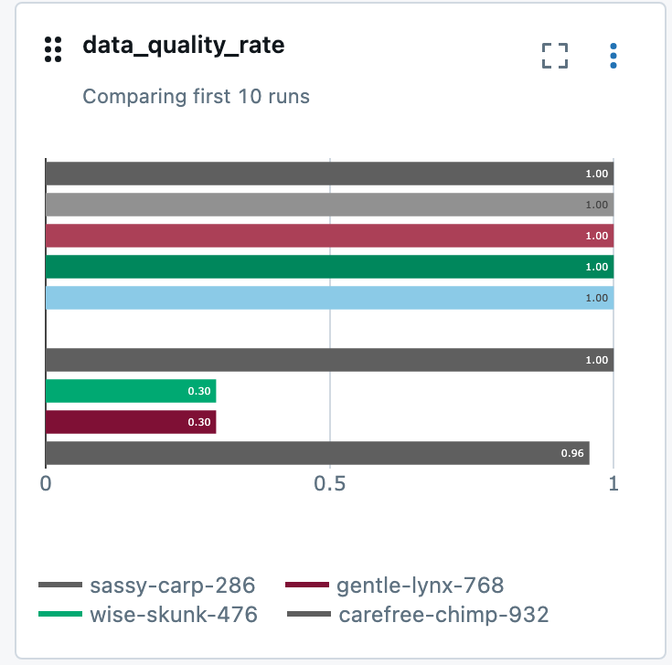
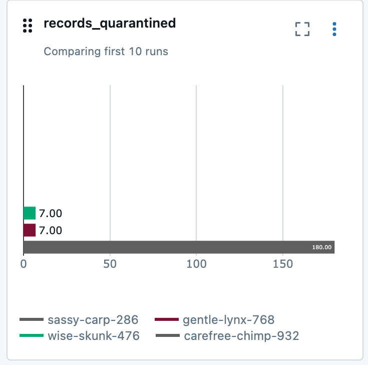
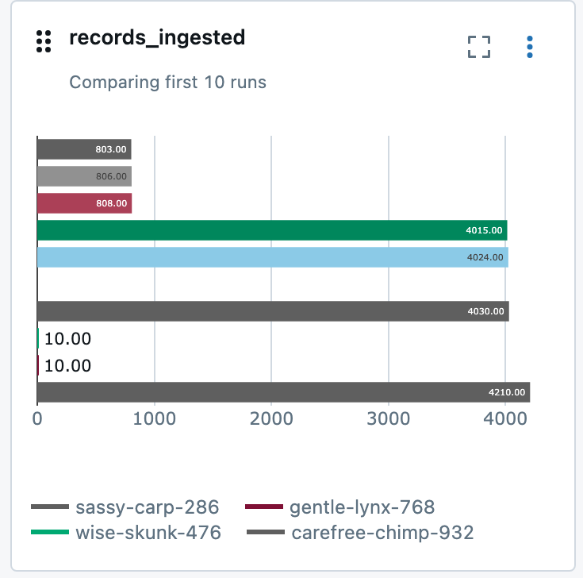
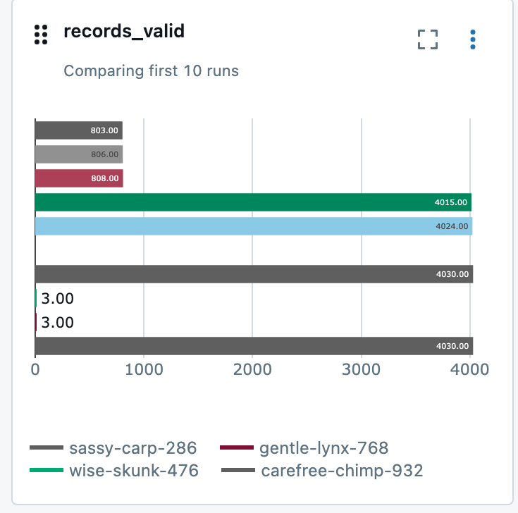
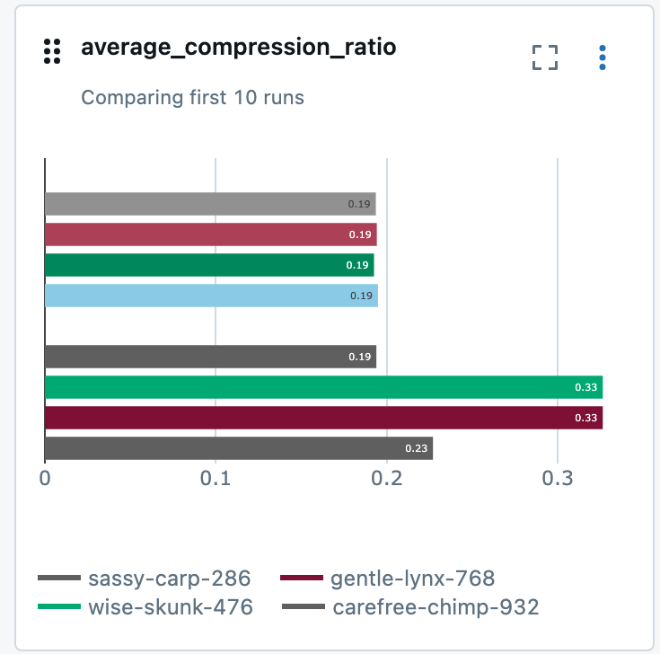

# News Article Pipeline

This is my take on the RAD AI data engineering take-home. The brief: read news
articles off a Kinesis stream, add a calculated feature like word count, work
out the average, and store the enriched articles in S3 in a way that's useful
for training a summarization model on a schedule.

I ended up going quite a bit further than that, mostly because the more I
thought about "data for training a model", the more I cared about whether the
data was actually right. So there's data quality checking, duplicate
detection, an extractive summary baseline, MLflow tracking, and a validator
that tells you whether every layer is consistent.

It's a long README, so here's what's in it:

- [How it works](#how-it-works)
- [Running it](#running-it)
- [How data quality works](#how-data-quality-works)
- [Under the hood](#under-the-hood)
- [The training data](#the-training-data)
- [Testing](#testing)
- [Recovery](#recovery)
- [Assumptions and limitations](#assumptions-and-limitations)
- [What I'd do next](#what-id-do-next)

## How it works

The pipeline follows a medallion architecture: raw data first, then cleaner and
more useful layers on top.

```
Kinesis (MyStream, LocalStack)
   │
   ├──► Data Incoming Issues      records that aren't valid JSON objects
   ▼
Bronze                   raw articles + where each one came from
   ▼
Data quality ──────────► quarantine (bad records, each with a reason)
   ▼
Near-duplicate check     MinHash LSH
   ▼
Silver                   all valid articles, duplicates flagged
   ▼
Gold                     one clean copy of each article
   ▼
Features + summary       word counts, article age, extractive summary
   ▼
ML-ready  ──►  ML training data (split into train / validation / test)
   ▼
Monitoring JSON in S3 + an MLflow run
```

Every article lands in Bronze exactly as it arrived, with lineage columns
(shard, sequence number, timestamps) so I can always trace a row back to the
stream. Anything broken goes to quarantine with a reason instead of
disappearing. Near-copies of the same story are flagged in Silver, and only
one copy of each article makes it into Gold and the ML datasets.

The pipeline remembers where it got to in the stream using a checkpoint in
S3, and only moves that checkpoint forward once the ML data has been written.
If something crashes halfway through, the next run just picks the same batch
up again. I learned that one the hard way (more in
[Checkpointing](#checkpointing)).

### Why Spark and not Flink

The assessment say a continuous stream, but it also says the model is
"trained on a regular schedule". Nothing needs results within seconds, so I
treated it as a micro-batch job: each run drains whatever's arrived since the
last checkpoint.

With that framing, Spark made more sense to me. One engine handles reading the
stream, the data quality checks, the features, the summaries and writing
Parquet, and the same code would run on a cluster without changes.
Partitioned Parquet on S3 is also exactly what training jobs want to read.
Flink would have meant running a JobManager, a TaskManager and a Kinesis
connector for no real benefit at this volume. If summaries ever had to appear
within seconds of an article arriving, I'd look at Spark Structured Streaming
or Flink.

## Running it

You'll need Docker, Python 3.10 and Java 17 or newer.

Start LocalStack and publish some articles (about 4,000):

```bash
docker compose up -d localstack
docker compose run --rm --no-deps article-publisher
```

Set up the processor:

```bash
cd processor
python3.10 -m venv .venv
.venv/bin/pip install -r requirements.txt
```

Run the pipeline:

```bash
export PYSPARK_PYTHON="$PWD/.venv/bin/python"
export PYSPARK_DRIVER_PYTHON="$PWD/.venv/bin/python"
.venv/bin/python -m src.pipeline
```

A good run ends with
`PIPELINE COMPLETED SUCCESSFULLY`.

Then check everything with the validator:

```bash
.venv/bin/python -m src.validate_pipeline
```

It's read-only, runs 24 checks across every layer.

A few other things you can run from `processor/` (same exports):

```bash
.venv/bin/python -m pytest -q tests          # unit tests (9 passing)
.venv/bin/python -m src.training             # builds the splits, logs the dataset version to MLflow
.venv/bin/python -m src.dataset_loader       # reads the training data with PyArrow, no Spark
.venv/bin/python -m src.evalution            # evaluates the summary baseline, logs to MLflow
.venv/bin/python -m src.backfill             # re-reads historical Bronze for reprocessing
.venv/bin/mlflow ui --backend-store-uri ./mlruns --port 5001
```

I use port 5001 for MLflow.

The `article-processor` service in `docker-compose.yml` runs the same pipeline
inside a container. All the results in this README came from the local
virtualenv run above, though, not the container.

## How data quality works

It needs an `article_id`, `source_id`, `title` and `body_text`, `published_at` has to be a
real date, and the body has to be at least 10 characters. If the same
`article_id` shows up twice in a batch, the later copy is quarantined. Every
rejected row records which rule it broke (`missing_title`,
`duplicate_article_id` and so on), so you can always see why.

Records that aren't even valid JSON never make it to Bronze. They go to a
Data Incoming Issues folder with the raw bytes and the parse error, and the pipeline
moves on. Before I added that, a bad record would just quietly disappear.

Near-duplicates are articles that say almost the same thing under different
IDs. I catch them with MinHash LSH, using a similarity threshold of 0.85. The
copy that arrived first is kept as the original, and the later ones are
marked as duplicates in Silver and kept out of Gold.

### The rules

A record goes to quarantine if any of these is true, and the row records
which rule it broke:

| Rule | `data_quality_issue` |
|---|---|
| `article_id` null or empty | `missing_article_id` |
| `source_id` null or empty | `missing_source_id` |
| `title` null or empty | `missing_title` |
| `body_text` null or empty | `missing_body_text` |
| `published_at` cannot be parsed | `invalid_published_at` |
| `body_text` shorter than 10 characters | `body_text_too_short` |
| Later copy of an `article_id` already in the batch (the earliest `published_at` is kept) | `duplicate_article_id` |

A record with no `article_id` only counts as `missing_article_id`. It isn't
also treated as a duplicate of every other record that's missing an ID. That
was a real bug I hit; see the [mixed batch test](#mixed-data-quality-batch).

### Malformed records

Malformed records never reach Bronze. These are payloads that aren't JSON,
or are JSON but not an object (an array, say). The reader writes each one to
the dead-letter area and then moves the checkpoint past it, so one bad record
can't block the stream. Each dead-letter file keeps the shard, sequence
number, partition key, arrival time, the parse error, a 500-character preview
and the full payload in base64, so nothing's lost. Files are named by sequence
number, so a replay overwrites them instead of making copies. The count goes
to monitoring and MLflow as `records_malformed`.

### Near-duplicates

Near-duplicates are articles whose text is at least 85% similar (MinHash
Jaccard ≥ 0.85). I process them in the order they arrived: by
`_source_timestamp`, then shard, then sequence number. The first copy to
arrive becomes the `canonical_article_id`, and later near-copies are marked
`is_duplicate = true`. They stay in Silver so you can trace them, but never
reach Gold.

Detection happens in two stages:

1. **Find candidates.** The LSH index uses a looser threshold
   (`CANDIDATE_THRESHOLD = 0.7`) and only suggests pairs worth comparing.
   LSH is probabilistic, so a single index set to 0.85 occasionally misses
   real matches. The 100k load test showed exactly that: it missed 5 of 2,500
   near-duplicates.
2. **Confirm them.** A candidate only counts if its MinHash similarity
   estimate is at least `LSH_THRESHOLD = 0.85`, and the article is linked to
   the most similar confirmed original.

## Under the hood

### The full flow

```
Kinesis (MyStream, LocalStack)
   │  boto3 GetRecords, per-shard checkpoint (TRIM_HORIZON / AFTER_SEQUENCE_NUMBER)
   ├──► Data Incoming Issues   records that are not a JSON object (raw bytes kept)
   ▼
BRONZE      raw articles + ingestion lineage, append, partitioned by _ingest_date
   ▼
DATA QUALITY   required fields, timestamp parsing, body length, exact-duplicate ids
   ├──► QUARANTINE   invalid / exact-duplicate rows, each with a reason
   ▼
SEMANTIC DEDUP   MinHash LSH (128 perms, 3-word shingles, Jaccard ≥ 0.85),
                 first copy to arrive is kept as canonical
   ▼
SILVER      all valid articles + is_duplicate / canonical_article_id / duplicate_group_id
   ▼
GOLD        canonical articles only (is_duplicate = false)
   ▼
FEATURES + EXTRACTIVE SUMMARY   word/sentence/char counts, age, summary, compression ratio
   ▼
ML-READY    Gold + features + summary (flat, append)
   ▼
ML TRAINING   ML-ready + deterministic `split`, partitioned split=/_ingest_date=
   │
   ▼
MONITORING JSON (S3)  +  MLFLOW RUN (local ./mlruns)

Consumers:  training.py (Spark, logs dataset version to MLflow)
            dataset_loader.py (PyArrow, no Spark: PyTorch / Hugging Face style batches)
```

### The code

Everything lives in `processor/src/`:

| Module | What it does |
|---|---|
| `config.py` | Endpoints, stream and bucket names, layer paths (all overridable by env var) |
| `kinesis_reader.py` | Reads every shard from its checkpoint, adds lineage columns, and sends malformed records to the dead-letter area |
| `checkpoint.py` | Loads and saves the per-shard checkpoint JSON in S3 |
| `data_quality.py` | Validation rules, exact-duplicate detection, valid/quarantine split |
| `deduplication.py` | MinHash LSH semantic deduplication (datasketch), processed in arrival order |
| `transformations.py` | Feature engineering, deterministic `split` assignment, partitioned training write |
| `summarization.py` | Extractive summarization (TF-IDF-style sentence scoring) as a Spark UDF |
| `monitoring.py` | Writes per-run metrics JSON to S3 |
| `mlflow_tracking.py` | Logs pipeline runs to the `news-summarization` MLflow experiment |
| `pipeline.py` | Runs every step end to end |
| `validate_pipeline.py` | Read-only end-to-end validator with PASS/FAIL output |
| `evalution.py` | Reference-free evaluation of the summarization baseline |
| `training.py` | Checks the training layout, selects the stored splits and logs the dataset version to MLflow |
| `dataset_loader.py` | Spark-free PyArrow loader that streams record batches per split and date range |
| `backfill.py` | Re-reads historical Bronze data for reprocessing |

There are also a few scripts in `processor/`. `recover_ml_ready.py` fixes one
specific kind of failed run (see [Recovery](#recovery)), and
`migrate_ml_training.py` copied the existing data into the training layout
once. The `publish_*.py` scripts generate test data; they're covered in
[Testing](#testing).

### S3 layout

It all lives in the `my-bucket` bucket, and Spark reads and writes it through
`s3a://`.

| Layer | Path | Write mode |
|---|---|---|
| Bronze | `s3://my-bucket/bronze/articles/` | append, `partitionBy(_ingest_date)` |
| Quarantine | `s3://my-bucket/quarantine/articles/` | append, only when invalid rows exist |
| Dead-letter | `s3://my-bucket/quarantine/malformed/shard=<id>/seq=<sequence>.json` | one JSON file per malformed record; overwritten on replay |
| Silver | `s3://my-bucket/silver/articles/` | append |
| Gold | `s3://my-bucket/gold/articles/` | append |
| ML-ready | `s3://my-bucket/ml-ready/` | append |
| ML training | `s3://my-bucket/ml/training/articles/` | append, `partitionBy(split, _ingest_date)`, one file per partition per batch |
| Monitoring | `s3://my-bucket/monitoring/pipeline_date=YYYY-MM-DD/run_<ts>.json` | one file per run |
| Checkpoint | `s3://my-bucket/checkpoints/kinesis/kinesis_checkpoint.json` | overwritten per run |

#### Columns

Bronze has 16 columns: the article fields as they were published, plus
lineage columns that say exactly where each row came from.

- Article fields: `article_id`, `source_id`, `source_name`, `title`, `author`, `body_text`, `url`, `published_at`, `language`
- Lineage: `_ingest_timestamp`, `_source_shard_id`, `_source_sequence_number`, `_source_timestamp`, `_record_key`, `_pipeline_version`, `_ingest_date`

Silver and Gold add three deduplication columns, `is_duplicate`,
`canonical_article_id` and `duplicate_group_id`, for 19 in total.

ML-ready adds the features and the summary, for 33 in total:

- Counts: `word_count`, `character_count`, `non_whitespace_character_count`, `title_word_count`, `sentence_count`, `avg_word_length`
- Content and timing: `has_content`, `published_timestamp`, `article_age_hours`, `processed_at`, `pipeline_version`
- Summary: `extractive_summary`, `summary_word_count`, `compression_ratio`

The ML training layout is ML-ready plus a `split` column (`train`,
`validation` or `test`), 34 columns in all. Both `split` and `_ingest_date`
are partition directories.

### Checkpointing

The reader stores the last sequence number it processed for each shard in
`kinesis_checkpoint.json`. The first run starts every shard at
`TRIM_HORIZON`, the oldest record available. After that it starts at
`AFTER_SEQUENCE_NUMBER`, just after the checkpoint.

The checkpoint only gets saved once the ML-ready and ML training writes have
both succeeded (Steps 11 and 11b in `pipeline.py`). If anything fails before
that, the next run replays the same batch, so nothing gets skipped without
anyone noticing.

It didn't start out that way. Originally I saved the checkpoint straight
after Bronze. On 2026-10-12 a run crashed at Step 10, leaving one batch in
Bronze, Silver and Gold but not in ML-ready, with the checkpoint already moved
past it. That's why I moved the save point, and why `recover_ml_ready.py`
exists.

The result is at-least-once delivery into every layer. The trade-off is
covered under [Assumptions and limitations](#assumptions-and-limitations).

## The training data

ML-ready is a flat table. For training, I write a second copy partitioned by
split and ingest date, so a training job can read just the training set, or
only data that came in since a given day. It lives at
`s3://my-bucket/ml/training/articles/`, and ML-ready stays the system of
record.

### Deterministic splits

Each article's split comes from its `article_id`:

```
bucket = xxhash64(article_id) mod 100
  0-79  -> train       (80%)
 80-89  -> validation  (10%)
 90-99  -> test        (10%)
```

### Layout

```
ml/training/articles/
  split=train/_ingest_date=2026-10-10/part-....snappy.parquet
  split=train/_ingest_date=2026-10-11/part-....snappy.parquet
  split=validation/...
  split=test/...
```

Partitioning by `split` and then `_ingest_date` means reading one split, or
"only data ingested since date X" for incremental retraining, only touches
those directories. Each batch writes one file per partition, which avoids the
pile-up of small files in ML-ready (its files range from 3.5 KB to 2.3 MB).
And since Parquet only reads the columns you ask for, a loader that wants
`body_text` and `extractive_summary` never touches the lineage or feature
columns.

### How it gets written

New batches are written here by `pipeline.py` in Step 11b, after ML-ready and
before the checkpoint is saved. The data that already existed was copied over
once by `migrate_ml_training.py`. It refuses to run if the target already has
data, checks the row counts match, and never modifies `ml-ready/`.

```bash
cd processor   # with the PYSPARK_* exports
.venv/bin/python migrate_ml_training.py   # one time only, before the next pipeline run
```

The migration (2026-10-12) wrote 17,699 rows into 6 partitions, one file
each:

| split | 2026-10-10 | 2026-10-11 | Total |
|---|---|---|---|
| train | 7,772 | 6,386 | 14,158 (79.99%) |
| validation | 924 | 801 | 1,725 (9.75%) |
| test | 964 | 852 | 1,816 (10.26%) |

The next pipeline run added 4,030 rows (3,233 train, 398 validation, 399
test), bringing the layout to 21,729 rows: 17,391 train, 2,123 validation and
2,215 test. That batch also carried `_ingest_date=2026-10-11`, so each
2026-10-11 directory now holds two files, one per batch. That's the kind of
small-file growth scheduled compaction would tidy up.

### Reading it

Without Spark, `src/dataset_loader.py` streams `pyarrow.RecordBatch` objects
for one split and, optionally, a date range. That's the shape a PyTorch
`IterableDataset` or Hugging Face `Dataset.from_generator` expects.

```python
from src.dataset_loader import iter_batches, count_rows

count_rows("validation")                                  # 1725
for batch in iter_batches("train", since="2026-10-11", batch_size=256):
    texts = batch.column("body_text").to_pylist()
    summaries = batch.column("extractive_summary").to_pylist()
```

The demo (`python -m src.dataset_loader`) prints:

```
train       rows: 14158
validation  rows: 1725
test        rows: 1816
First train batch: 4 rows x 7 columns ['article_id', 'title', 'body_text', 'extractive_summary', 'word_count', 'summary_word_count', 'compression_ratio']
Train files read for split='train': 2
```

With Spark, `training.py` reads the layout, checks the rows, selects the
stored splits and logs a dataset version to MLflow. The run is called
`training-dataset` and tagged `run_type=training_dataset`. It logs rows per
split as metrics, plus the dataset path, partitioning, split method, first
and last `_ingest_date` and a schema hash as parameters. The run I made right
after the migration on 2026-10-12:

| Field | Value |
|---|---|
| rows_total / train / validation / test | 17,699 / 14,158 / 1,725 / 1,816 |
| ingest_date_first .. last | 2026-10-10 .. 2026-10-11 |
| schema_hash | `414c4555c539` |

A future model-training run can log the same parameters, so every model can
be traced back to exactly the data it was trained on.

## Testing

The publisher's fake articles are always clean, so normal runs never actually
exercise quarantine or duplicate detection. A pipeline that's only ever seen
good data hasn't really been tested, so I wrote generators that feed in bad
records where I know exactly what should happen, then compared the pipeline's
numbers against my predictions.

I did that at three sizes: a 12-record batch I could follow by hand, a
4,210-record mixed batch, and a 100,000-record load test with about 20% bad
data in its own isolated stream and bucket. Every data quality number came
out exactly as planned at all three sizes. In the 4,210-record batch that was
4,030 valid, 100 invalid, 80 exact duplicates and 180 quarantined. In the 100k
run it was 12,000 invalid, 5,000 exact duplicates, 17,000 quarantined, and
500 malformed records in the dead-letter folder.

Honestly, the most useful part was what broke. Testing turned up five real
problems, and I fixed every one of them:

- Exact duplicates were quarantined without a reason.
- When two near-copies came in, the code kept whichever ID sorted first
  instead of whichever arrived first.
- Malformed records were dropped with nothing but a log line.
- Records with no ID were being counted as duplicates of each other, which
  threw off the summary numbers.
- In the 100k run, 5 of 2,500 near-duplicates slipped through because LSH
  never paired them up for comparison. I changed it to a two-stage check
  (find candidates at 0.7, confirm at 0.85), which caught 2,500 out of 2,500
  on the same data. A 25k re-run then caught 625 out of 625.

The rest of this section has the details: the validator, the normal runs,
each test, and the MLflow charts.

### The validator

I wanted one command that answers "is everything actually right, right now?",
so I wrote `src/validate_pipeline.py`. It only reads: it never writes to S3,
Kinesis or the checkpoint. It prints PASS or FAIL for each check, then a
summary, and exits with `1` if anything fails, so it can gate other jobs.

| Group | What it checks |
|---|---|
| Infrastructure | LocalStack health (kinesis, s3); `MyStream` is ACTIVE; `my-bucket` exists; checkpoint JSON exists |
| Layers | Bronze, Silver, Gold, ML-ready and ML training readable with their expected columns |
| Consistency | Silver traces to Bronze and has no duplicate records; Bronze unique records = valid + quarantined; Gold = Silver canonical; ML-ready = Gold (by `article_id`, both directions) |
| Keys | No null, empty or duplicate `article_id` in Gold or ML-ready |
| Feature ranges | `word_count > 0`; `0 < compression_ratio < 1`; `summary_word_count ≤ word_count`; averages reported |
| ML training layout | Same articles as ML-ready (both directions); every stored `split` matches the `article_id` hash; each article in exactly one split with one row; split ratio within ±2 points of 80/10/10 |
| Observability | Latest monitoring JSON exists; latest MLflow pipeline run exists and is FINISHED |

Here's the output from 2026-10-12, after the mixed data-quality batch:

```
======================================================================
PIPELINE VALIDATION (read-only)
======================================================================
[PASS] LocalStack reachable (kinesis, s3) -- http://localhost:4566 {'kinesis': 'running', 's3': 'running'}
[PASS] Kinesis stream ACTIVE -- MyStream ACTIVE, 1 shard(s)
[PASS] S3 bucket exists -- my-bucket
[PASS] Kinesis checkpoint JSON exists -- s3://my-bucket/checkpoints/kinesis/kinesis_checkpoint.json -> 1 shard(s)
[PASS] Bronze exists with expected columns -- s3://my-bucket/bronze/articles/ (16 columns)
[PASS] Silver exists with expected columns -- s3://my-bucket/silver/articles/ (19 columns)
[PASS] Gold exists with expected columns -- s3://my-bucket/gold/articles/ (19 columns)
[PASS] ML-ready exists with expected columns -- s3://my-bucket/ml-ready/ (33 columns)
[PASS] ML training exists with expected columns -- s3://my-bucket/ml/training/articles/ (34 columns)
[INFO] Row counts: Bronze=40449 (unique Kinesis records=25959), Quarantine=194, Silver=25765, Gold=25763, ML-ready=25763
[INFO] Malformed (non-JSON) records in dead-letter: 2 under s3://my-bucket/quarantine/malformed/ (never reach Bronze)
[INFO] Bronze holds 14490 replayed rows (same Kinesis sequence number ingested more than once); consistency checks use unique records.
[PASS] Silver = Bronze valid rows -- Silver=25765, Silver rows not traceable to Bronze=0, duplicate Silver records=0
[PASS] Bronze = valid + quarantined -- Bronze unique=25959, valid(25765) + quarantined(194)=25959
[PASS] Gold = Silver canonical rows -- Gold=25763, Silver canonical=25763, duplicates in Gold=0
[PASS] ML-ready = Gold -- ML-ready=25763, Gold=25763, Gold ids missing from ML-ready=0, ML-ready ids not in Gold=0
[PASS] Gold article_id not null and unique -- rows=25763, null/empty=0, duplicates=0
[PASS] ML-ready article_id not null and unique -- rows=25763, null/empty=0, duplicates=0
[PASS] word_count > 0 -- rows with word_count <= 0 or null: 0
[PASS] 0 < compression_ratio < 1 -- rows outside (0, 1): 0, min=0.0876, max=0.3386
[PASS] summary_word_count <= word_count -- rows with summary_word_count > word_count: 0
[INFO] Average word_count=138.65, average summary_word_count=27.35, average compression_ratio=0.1988
[INFO] ML training rows by split: {'train': 20626, 'test': 2594, 'validation': 2543}, 9 split/_ingest_date partitions
[PASS] ML training = ML-ready -- ML training=25763, ML-ready=25763, ML-ready ids missing from training=0, training ids not in ML-ready=0
[PASS] ML training split matches article_id hash -- rows whose stored split differs from the article_id hash: 0
[PASS] ML training article in exactly one split -- articles in more than one split=0, articles with more than one row=0
[PASS] ML training split ratio ~80/10/10 -- train=80.06%, validation=9.87%, test=10.07% (target 80/10/10, tolerance +/-2.0pp)
[PASS] Latest monitoring JSON exists -- s3://my-bucket/monitoring/pipeline_date=2026-10-12/run_20261012T131917854447Z.json (recorded_at=2026-10-12T13:19:17.854447+00:00, records_ingested=4210)
[PASS] Latest MLflow pipeline run exists -- run_id=24ddb8df903146329499f49a086c057b, status=FINISHED, started=2026-10-12 13:19:18.016000+00:00, records_ingested=4210
======================================================================
SUMMARY: 24 passed, 0 failed, 24 checks
RESULT: PASS
======================================================================
```

To make sure it really does fail when something's wrong, I also pointed it at
a bucket that doesn't exist. It printed `[FAIL] S3 bucket exists`, then
`RESULT: FAIL`, and exited with `1`.

### Normal runs

These use the standard publisher, which only produces clean articles.

#### Latest end-to-end run (2026-10-12)

The publisher sent 4,030 new articles, and one `python -m src.pipeline` run
took them all the way through, including the training layout (Step 11b). The
checkpoint was saved after that.

| Stage | Result |
|---|---|
| Read from Kinesis | 4,030 new records after the saved checkpoint |
| Data quality | 4,030 valid, 0 invalid, 0 exact duplicates, 0 quarantined |
| Semantic dedup | 4,030 canonical, 0 semantic duplicates |
| Summaries | 4,030 generated (rate 1.0) |
| Batch averages | 137.85 words per article, 26.46 summary words, compression ratio 0.1940 |
| ML training write | train 3,233 / validation 398 / test 399 |
| Checkpoint | Advanced after the ML-ready and ML training writes |
| Monitoring / MLflow | `run_20261012T015523962173Z.json` written; MLflow run logged |
| Validator | 24/24 PASS |

Every layer grew by exactly the size of the batch:

| Layer | Before | After | Δ |
|---|---|---|---|
| Bronze | 32,189 | 36,219 | +4,030 |
| Silver | 17,699 | 21,729 | +4,030 |
| Gold | 17,699 | 21,729 | +4,030 |
| ML-ready | 17,699 | 21,729 | +4,030 |
| ML training | 17,699 | 21,729 | +4,030 |

#### The run before it

The first run after I moved the checkpoint to the end of the pipeline
processed 4,024 articles. There were no invalid records and no
near-duplicates, and the batch averaged 138.10 words, 26.65 summary words and
a compression ratio of 0.1949. Every layer grew by 4,024 rows: Bronze from
28,165 to 32,189, and Silver, Gold and ML-ready each from 13,675 to 17,699.

#### The dataset as a whole

At 21,729 articles, measured before the test batches below added their test
rows (`dqtest-*`):

| Metric | Value |
|---|---|
| Average word count | 138.10 |
| Average summary word count | 26.46 |
| Average compression ratio | 0.1935 (min 0.0876, max 0.3222) |
| Training split | train 17,391 (80.04%) / validation 2,123 (9.77%) / test 2,215 (10.19%) |

The earlier 9,660-article batch (2026-10-10) averaged 138.04 words, 26.40
summary words and a compression ratio of 0.1932, so the baseline is steady
from batch to batch.

### Testing the failure paths

These are the three tests with bad data, smallest first.

#### Small labelled batch

The first one is small enough to follow record by record.
`publish_dq_test_records.py` sends 12 records, each aimed at one rule. They
all use `source_name = "DQ Test Source"` and an `article_id` starting with
`dqtest-`, so they're easy to filter out later.

```bash
.venv/bin/python publish_dq_test_records.py   # from processor/, then run the pipeline
```

| # | Test record | Result |
|---|---|---|
| 1 | Valid article A | Silver, Gold, ML-ready, training layout; canonical of the A pair |
| 2 | Valid article B | Silver, Gold, ML-ready, training layout |
| 3 | Near-copy of A, arriving later (one word changed, new id) | Silver with `is_duplicate = true`, canonical = A; not in Gold |
| 4 | Exact copy of B (same `article_id`) | Quarantine: `duplicate_article_id` |
| 5 | No `article_id` | Quarantine: `missing_article_id` |
| 6 | Empty `source_id` | Quarantine: `missing_source_id` |
| 7 | No `title` | Quarantine: `missing_title` |
| 8 | Empty `body_text` | Quarantine: `missing_body_text` |
| 9 | `published_at = "not-a-date"` | Quarantine: `invalid_published_at` |
| 10 | `body_text = "Too short"` | Quarantine: `body_text_too_short` |
| 11 | Payload that is not JSON | Dead-letter: `JSONDecodeError`, never in Bronze |
| 12 | Payload that is a JSON array | Dead-letter: "valid JSON but not an object", never in Bronze |

It came out exactly as predicted. The 2 malformed records went to the
dead-letter area. Of the 10 records read in, 6 were invalid and 1 was an
exact duplicate, so 7 went to quarantine. The 3 valid ones went to Silver;
one was a near-duplicate, so Gold, ML-ready and the training layout each grew
by 2. The checkpoint moved past the last (malformed) record, and the
validator passed 24/24, including Bronze unique (21,749) = valid (21,735) +
quarantined (14).

That was actually my second go. The first run, before any fixes, turned up
three real problems:

- The exact duplicate went to quarantine with no reason recorded.
- The near-copy that arrived later was kept as the original, because the code
  picked whichever `article_id` sorted first rather than whichever arrived
  first.
- Malformed records were silently dropped, with nothing but a log line.

I fixed all three and added a unit test for each. The 7 quarantine rows from
that first run (one with the empty reason) are still in the quarantine table.

#### Mixed data-quality batch

Next I wanted to see whether it holds up at a realistic batch size.
`publish_mixed_batch.py` sends 4,210 records in one go: 4,030 valid articles,
100 invalid records spread across the six rules, and 80 exact duplicates
(later copies of 80 of the valid articles). They're shuffled together, use
`source_name = "DQ Test Source"`, and have IDs starting with `dqtest-mixed-`.
The text comes from a fixed vocabulary and a seeded random generator, so the
batch is reproducible and doesn't need any extra libraries.

```bash
.venv/bin/python publish_mixed_batch.py --dry-run   # preview the data quality result, no writes
.venv/bin/python publish_mixed_batch.py             # publish it, then run the pipeline
```

The pipeline's own data quality summary from the run:

```
Total records:           4210
Invalid records:         100
Exact duplicates:        80
Valid records:           4030

|data_quality_issue  |count|
|duplicate_article_id|80   |
|missing_source_id   |17   |
|missing_body_text   |17   |
|missing_article_id  |17   |
|missing_title       |17   |
|invalid_published_at|16   |
|body_text_too_short |16   |

Valid records: 4030
Quarantine records: 180
```

| Stage | Result |
|---|---|
| Read from Kinesis | 4,210 records, 0 malformed |
| Data quality | **4,030 valid, 100 invalid, 80 exact duplicates, 180 quarantined** (data-quality rate 0.957) |
| Semantic dedup | 4,030 canonical, 0 semantic duplicates |
| Silver / Gold / ML-ready | +4,030 each |
| ML training | train 3,232 / validation 420 / test 378 |
| Checkpoint, monitoring, MLflow | advanced; `run_20261012T131917854447Z.json` written; run logged |
| Validator | 24/24 PASS; Bronze unique 25,959 = valid 25,765 + quarantined 194 |

Quarantine always equals invalid plus exact duplicates (100 + 80 = 180 here),
and the validator checks that across the whole dataset.

This one caught a bug too. Before publishing, I ran the batch through the
data quality code locally (`--dry-run`, no writes), and the summary said
"Exact duplicates: 96" and "Valid records: 4,014". The 17 records with no
`article_id` had been grouped together and counted as duplicates of each
other on top of being invalid. The records themselves were sorted correctly
(4,030 kept, 180 quarantined); only the summary was wrong. Duplicate detection
now ignores missing and empty IDs, there's a unit test for it, and the
numbers above are from after the fix.


##### 25k Data Quality load Test


| Stage | Expected | Actual |
|---|---|---|
| Malformed → dead-letter | 125 | **125** |
| Ingested into Bronze | 24,875 | **24,875** |
| Invalid | 3,000 (500 per rule) | **3,000**, exactly 500 for each of the six reasons |
| Exact duplicates | 1,250 | **1,250** |
| Quarantined | 4,250 | **4,250** |
| Valid → Silver | 20,625 | **20,625** (data-quality rate 0.829) |
| Semantic duplicates | 625 | **625 / 625**: none missed, none in Gold, all linked to their original |
| Gold / ML-ready / ML training | 20,000 | **20,000** (train 16,018 / validation 2,000 / test 1,982) |
| Validator (test bucket) | 24/24 | **24/24 PASS**; Bronze 24,875 = valid 20,625 + quarantined 4,250 |

The Kinesis engine stayed up the whole time, and `MyStream` was never
affected.

### MLflow

Every pipeline run logs its metrics to the `news-summarization` experiment.
They're the same numbers that go into the monitoring JSON in S3. Training
runs add a `training-dataset` run (rows per split, `_ingest_date` range and a
schema hash), and `evalution.py` logs to `news-summarization-baseline`. To
open the UI, run
`.venv/bin/mlflow ui --backend-store-uri ./mlruns --port 5001` from
`processor/` and go to http://127.0.0.1:5001. These screenshots are from
2026-10-12.



What each run was:

| Run | Records ingested | Valid | Quarantined | Data-quality rate | What it was |
|---|---|---|---|---|---|
| `sassy-carp-286` | 4,210 | 4,030 | 180 | 0.957 | Mixed data-quality batch (100 invalid + 80 exact duplicates) |
| `gentle-lynx-768` | 10 | 3 | 7 | 0.300 | 12-record DQ test batch, after the fixes (plus 2 malformed) |
| `wise-skunk-476` | 10 | 3 | 7 | 0.300 | 10-record DQ test batch, before the fixes |
| `carefree-chimp-932` | 4,030 | 4,030 | 0 | 1.000 | First run that also wrote the ML training layout |
| `training-dataset` | n/a | n/a | n/a | n/a | Dataset version: 17,699 rows (14,158 / 1,725 / 1,816) |
| `languid-seal-440` | 4,024 | 4,024 | 0 | 1.000 | Fresh run with the checkpoint saved after ML-ready |
| `monumental-shark-717` | 4,015 | 4,015 | 0 | 1.000 | `recover_ml_ready.py` recovery run |
| `bedecked-rat-107`, `clean-bat-227`, `grandiose-shrew-441` | about 800 each | all | 0 | 1.000 | Early runs (2026-10-07) |

In the charts, each bar is a run, with the oldest at the top and the newest
(`sassy-carp-286`) at the bottom. The `training-dataset` run has no pipeline
metrics, so it's an empty row. The legend only lists the first four runs, so
use the table above to tell the bars apart.

| Data-quality rate | Records quarantined |
|---|---|
|  |  |
| 1.00 for the clean bulk runs, 0.96 for the 4,210-record mixed batch, 0.30 for the two 10-record test batches (7 of 10 bad by design). | 180 for the mixed batch (100 invalid + 80 exact duplicates), 7 for each small test batch, 0 elsewhere. |

| Records ingested | Records valid |
|---|---|
|  |  |
| About 800 per early run, about 4,000 per bulk run, 10 per small test batch, 4,210 for the mixed batch. | Equal to records ingested on clean runs. 3 of 10 on the test batches; 4,030 of 4,210 on the mixed batch. |



On the Faker articles, the summaries keep about 19% of the words. The
generated test batches compress less: 0.33 on the 10-record batches and 0.23
on the mixed batch. The earliest run (`grandiose-shrew-441`, top row) has no
bar because that early version of the pipeline logged a ratio of 0.

The 100k and 25k load-test runs used their own MLflow stores
(`mlruns-dqtest*`), which I removed during cleanup, so they don't show up
here.

## Recovery

`recover_ml_ready.py` is only needed if a batch reached Gold but its
checkpoint had already moved on before ML-ready was written. That could only
happen before the checkpoint fix, so it's mostly a record of how I repaired
the one time it did.

It picks the Gold rows whose `_source_sequence_number` comes after a given
previous checkpoint, re-runs feature engineering, summarization and the
statistics for them, and appends them to ML-ready. It also writes a monitoring
JSON tagged `run_type: recovery` and an MLflow run. It's careful about what it
touches: it never reads Kinesis or changes the checkpoint, and if any row from
the batch is already in ML-ready, it stops before writing anything.

```bash
cd processor
export PYSPARK_PYTHON="$PWD/.venv/bin/python" PYSPARK_DRIVER_PYTHON="$PWD/.venv/bin/python"
.venv/bin/python recover_ml_ready.py
```

I used it once, on 2026-10-12. A run had failed at Step 10 with
`PYTHON_VERSION_MISMATCH` after appending 4,015 rows to Bronze, Silver and
Gold. The recovery added the same 4,015 rows to ML-ready (9,660 → 13,675),
with no duplicates. If you ever reuse it, set `PREVIOUS_CHECKPOINT` in the
script first.

## Assumptions and limitations

- **Micro-batches, not real time.** The brief doesn't say batch or streaming.
  It describes a continuous stream feeding a model that's "trained on a
  regular schedule", so I run scheduled, checkpointed micro-batches.
  Per-record, low-latency output is out of scope.
- **No reference summaries.** There are no human-written summaries in the
  data, which limits what I can honestly claim:
  - The summarizer is an unsupervised extractive baseline. It scores each
    sentence by the average IDF of its words and keeps 25% of the sentences,
    between 2 and 5.
  - Evaluation is reference-free: coverage, length and compression ratio.
  - I don't report ROUGE scores and I don't train a supervised model.
    `training.py` prepares the stored 80/10/10 splits ready for when
    reference summaries exist.
- **Engagement data.** I treated engagement metrics (views, shares) as a
  separate event stream. I didn't invent them or add them to article records.
- **At-least-once delivery.** Every layer is append-only Parquet. If a run
  fails after Bronze but before the checkpoint is saved, the next run replays
  the batch. Bronze, and possibly Silver, Gold, ML-ready and the training
  layout, can then get that batch twice. The validator would flag it as
  duplicate `article_id`s.
- **The training data is a second copy.** ML-ready and the training layout
  hold the same rows (the validator checks this). It doubles the storage in
  exchange for a layout built for training.
- **Bronze has replayed rows.** Bronze holds 40,449 rows but only 25,959
  unique Kinesis sequence numbers:
  - By `_ingest_date`: 2,415 rows on 2026-10-06, 7,247 on 2026-10-07, 4,828
    on 2026-10-09, 9,660 on 2026-10-10, 12,069 on 2026-10-11 (the 4,015 +
    4,024 + 4,030 batches) and 4,230 on 2026-10-12 (the two 10-record DQ test
    batches plus the 4,210-record mixed batch). Dates are in local time.
  - The 2026-10-10 run read the whole stream again from `TRIM_HORIZON`, so it
    re-ingested the 9,660 records earlier runs had already landed. The extra
    rows are those earlier copies: 2,415 + 7,247 + 4,828 = 14,490.
  - I've left Bronze as it is, because it's the raw landing zone.
  - Everything downstream is clean. Every unique Kinesis record is either in
    Silver (25,765) or in quarantine (194). Gold, ML-ready and the training
    layout hold 25,763 rows with unique `article_id`s, and no run since the
    2026-10-10 replay has added replayed rows. The validator checks Bronze
    against unique sequence numbers and reports the replay count rather than
    hiding it.
- **Near-duplicate detection only looks within a batch.** A near-copy that
  arrives in a later batch would reach Gold.
- **The data is synthetic.** The publisher generates Faker articles, which is
  why the bulk runs have no invalid records and no near-duplicates. The test
  rows (`dqtest-*`) are still in the layers and can be filtered out by
  `source_name`. The mixed batch alone adds 4,030 synthetic valid articles,
  about 16% of Gold, ML-ready and the training layout, and their generated
  text compresses differently (average compression ratio 0.227, against about
  0.19 for the Faker articles). Filter on `source_name != "DQ Test Source"`
  before any real training or reporting.
- **An edge case with exact duplicates.** They're ranked by `published_at`,
  and the earliest copy is kept. If that copy is itself invalid, both copies
  end up in quarantine.

## What I'd do next

If this were going to production, this is what I'd change, roughly in order
of value. The first one matters most, because it gets rid of the
at-least-once caveat altogether.

1. **A transactional table format.** Move to Delta Lake, Apache Iceberg and `MERGE` on `_source_sequence_number` / `article_id`.
5. **Orchestration.** Schedule ingest → validate → train in Airflow, Dagster
   or Step Functions, and only let training start when `validate_pipeline`
   exits with `0`.
6. **Monitoring and alerting.** Push the metrics to CloudWatch or Prometheus
   and alert on the quality rate, quarantine spikes, compression-ratio drift
   and Kinesis iterator age.
7. **Model quality.** Collect reference summaries, add ROUGE and BERTScore,
   and compare those models against the baseline in MLflow.
